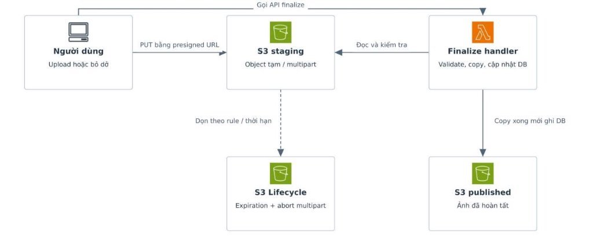

# Quản lý vòng đời đối tượng trên Amazon S3 để tối ưu chi phí lưu trữ

## Tổng quan

Các đối tượng được lưu trên Amazon S3 không phải lúc nào cũng cần giữ nguyên một storage class trong suốt vòng đời. Chẳng hạn, một tệp có thể được truy cập thường xuyên ngay sau khi tải lên nhưng ít được sử dụng hơn sau một khoảng thời gian. Việc giữ tất cả dữ liệu trong storage class có chi phí cao có thể làm tăng chi phí lưu trữ không cần thiết.

Amazon S3 Lifecycle hỗ trợ tự động hóa quá trình này. Thông qua lifecycle rules, quản trị viên có thể xác định thời điểm đối tượng được chuyển sang storage class khác hoặc hết hạn sau khi không còn cần thiết. Cách tiếp cận này giảm thao tác dọn dẹp thủ công và giúp quản lý dữ liệu nhất quán hơn khi dung lượng lưu trữ tăng lên.

## Các điểm chính cần nắm

* Một lifecycle configuration gồm các rules áp dụng cho toàn bộ đối tượng trong bucket hoặc cho nhóm đối tượng được chọn bằng bộ lọc như prefix hay object tags.
* Hành động **Transition** chuyển các đối tượng đủ điều kiện sang storage class được chọn sau một khoảng thời gian hoặc tại một thời điểm xác định.
* Hành động **Expiration** xóa đối tượng khi đạt đến thời hạn lưu trữ đã cấu hình.
* Với bucket bật versioning, lifecycle còn có thể quản lý các phiên bản cũ thông qua những hành động riêng như chuyển hoặc hết hạn noncurrent versions.
* Mỗi storage class có đặc điểm khác nhau về chi phí, khả năng truy xuất, tính sẵn sàng và thời gian lưu trữ tối thiểu. Vì vậy, cần chọn storage class dựa trên tần suất truy cập dự kiến, không chỉ dựa vào giá lưu trữ.
* Lifecycle rules phù hợp để tự động hóa chính sách lưu giữ dữ liệu cho tệp tải lên tạm thời, application logs, bản sao lưu và dữ liệu lưu trữ dài hạn.

## Ví dụ sử dụng

Xét một ứng dụng tiếp nhận tệp thông qua quy trình upload. Các đối tượng mới tải lên có thể cần được giữ trong storage class dễ truy cập trong lúc hệ thống xử lý. Khi những tệp này không còn được sử dụng thường xuyên, lifecycle rule có thể chuyển chúng sang storage class tiết kiệm hơn. Các đối tượng tạm thời cũng có thể được tự động hết hạn sau khoảng thời gian lưu giữ do ứng dụng quy định.

Cách làm này tách biệt logic upload và xử lý của ứng dụng khỏi công việc quản lý lưu trữ dài hạn. Ứng dụng không cần chạy một tác vụ định kỳ để kiểm tra từng đối tượng rồi tự di chuyển hoặc xóa chúng.

## Những điểm cần lưu ý

Trước khi bật lifecycle rule, cần xác định chính xác nhóm đối tượng chịu tác động và kiểm tra yêu cầu lưu giữ dữ liệu. Với bucket bật versioning, việc hết hạn phiên bản hiện tại có thể tạo delete marker thay vì xóa vĩnh viễn mọi phiên bản đã lưu. Vì vậy, các phiên bản cũ có thể cần lifecycle actions riêng. Ngoài ra, cần xem xét phí truy xuất và thời gian lưu trữ tối thiểu của storage class được chọn.

## Hình ảnh

## Link

[Bài đăng trên AWS Study Group (Facebook)](https://www.facebook.com/photo?fbid=2560728657741442&set=gm.2312347569530202&idorvanity=660548818043427)

## Tài liệu hướng dẫn

* [Quản lý vòng đời lưu trữ Amazon S3](https://docs.aws.amazon.com/AmazonS3/latest/userguide/object-lifecycle-mgmt.html)
* [Các thành phần của lifecycle configuration](https://docs.aws.amazon.com/AmazonS3/latest/userguide/intro-lifecycle-rules.html)
