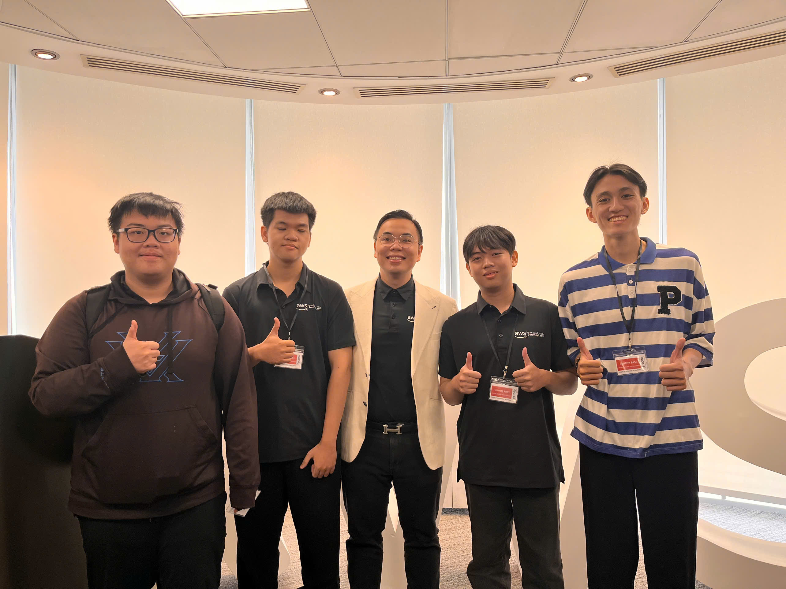

# **Event 1: Buildrathon – Kickoff: Code the Future with CMC Global**

**Date:** Saturday, September 26, 2026  
**Time:** 10:30 AM – 12:00 PM (GMT+7)  
**Location:** AWS Vietnam Office, Bitexco Financial Tower, 02 Hai Trieu Street, Ho Chi Minh City, Vietnam.  
**Role:** Attendee  
**Event Post:** [View on Facebook – AWS Study Group](https://www.facebook.com/share/p/19UirpT2JW/)

### **Event Objectives**

* Officially kick off **FCAJ Buildrathon 2026 Season 01**, creating a hands-on arena for builders to craft real-world Cloud and AI applications.
* Outline the program roadmap, upcoming milestones, and technical challenges for participating teams.
* Examine practical strategies for designing and tuning AI Agents through the talk show *"The Thinking Behind Building The Bot"*.
* Foster networking and direct knowledge exchange between attendees, AWS Study Group mentors, and engineers from CMC Global.
* Provide realistic guidance on career pathways and core competencies needed in enterprise Cloud and AI roles.

### **Speakers & Participating Organizations**

* **AWS Study Group:** Host community driving the First Cloud AI Journey initiative and connecting cloud builders across Vietnam.
* **CMC Global:** Partner organization contributing real-world perspectives on AI Agent engineering, challenge mentoring, and career recruitment.
* **Industry Practitioners:** Experienced engineers discussing how enterprise teams scope, build, and maintain production AI systems.

### **Key Highlights**

#### **FCAJ Buildrathon 2026 Season 01 Launch**
* Introduced the full season structure and key milestones designed to push teams from concept to working Cloud + AI prototypes.
* Highlighted why learning by building—solving tangible user problems rather than stopping at theory—accelerates technical growth.
* Energized a crowd of over 300 participants gathered at the AWS Vietnam office.

#### **Talk Show: "The Thinking Behind Building The Bot"**
* Walked through the decision-making process behind effective AI Agents, starting with clear problem framing and architecture choices before writing code.
* Emphasized that reliable enterprise bots rely heavily on workflow orchestration, guardrails, and system design—not just picking a strong foundation model.

#### **AI Agent Challenge**
* Presented the technical problem space and showed how to break down ambiguous requirements into testable system components.
* Stressed iterative validation, evaluation metrics, and combining serverless cloud services with AI capabilities to deliver resilient products.

#### **Career Pathways with CMC Global**
* Shared what engineering managers look for in junior Cloud and AI talent: practical project portfolios, self-learning habits, and strong teamwork.
* Offered open Q&A and direct conversations with CMC Global's recruitment and engineering representatives.

### **Key Takeaways & Application**

* **Architecture-First AI Mindset:** Effective AI features start with a well-defined user problem, a fitting cloud architecture, and continuous testing—never model hype alone.
* **Preparation for Upcoming Team Projects:** Applied the structured problem-analysis and technology-selection mindset to later team discussions and AWS service research for data processing and AI workflows.
* **Stronger Collaboration & Self-Learning:** Improved how I split tasks, document decisions with teammates, and pursue hands-on Cloud and Generative AI learning throughout the FCAJ program.

### **Event Experience**

Joining over 300 fellow builders at the AWS Vietnam office made the kickoff genuinely inspiring. Beyond the technical insights from *"The Thinking Behind Building The Bot"*, experiencing the AWS Study Group's *"Pay It Forward"* culture reinforced how valuable open community learning is. The session left me with clearer direction on how to combine cloud fundamentals with AI engineering and stronger motivation to build practical, end-to-end solutions during the internship.

### **Event Photos**

