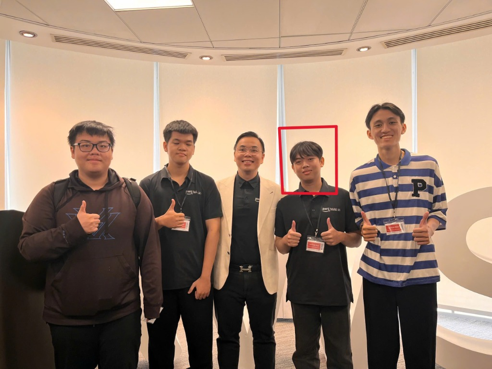

# **Sự kiện 1: Buildrathon – Khởi động: Kiến tạo tương lai cùng CMC Global**

**Ngày:** Thứ Bảy, ngày 26 tháng 09 năm 2026  
**Thời gian:** 10:30 AM – 12:00 PM (GMT+7)  
**Địa điểm:** Văn phòng AWS Việt Nam, Tòa nhà Bitexco Financial Tower, số 02 Hải Triều, TP. Hồ Chí Minh, Việt Nam.  
**Vai trò:** Người tham dự  
**Bài đăng sự kiện:** [Xem trên Facebook – AWS Study Group](https://www.facebook.com/share/p/19UirpT2JW/)

### **Mục tiêu sự kiện**

* Chính thức khởi động **FCAJ Buildrathon 2026 Mùa 01**, mở ra sân chơi thực chiến giúp người tham gia xây dựng các giải pháp ứng dụng Cloud và AI.
* Công bố lộ trình hoạt động, các mốc thời gian và định hướng thử thách xuyên suốt chương trình.
* Chia sẻ tư duy thiết kế và tối ưu AI Agent qua buổi tọa đàm *"The Thinking Behind Building The Bot"*.
* Tạo cầu nối giao lưu, học hỏi trực tiếp giữa cộng đồng với các chuyên gia từ AWS Study Group và CMC Global.
* Mang đến góc nhìn thực tế về cơ hội nghề nghiệp và năng lực cần chuẩn bị trong lĩnh vực Điện toán đám mây và Trí tuệ nhân tạo.

### **Diễn giả & Đơn vị đồng hành**

* **AWS Study Group:** Cộng đồng tổ chức chương trình, gắn kết những người yêu thích và nghiên cứu AWS Cloud cùng AI tại Việt Nam.
* **CMC Global:** Đơn vị đồng hành chia sẻ kinh nghiệm triển khai AI Agent thực tế, định hướng thử thách kỹ thuật và cơ hội tuyển dụng.
* **Các chuyên gia công nghệ:** Đội ngũ kỹ sư giàu kinh nghiệm chia sẻ cách bài toán AI được phân tích, xây dựng và vận hành trong môi trường doanh nghiệp.

### **Nội dung nổi bật**

#### **Khởi động FCAJ Buildrathon 2026 Mùa 01**
* Giới thiệu bức tranh tổng thể về mùa giải đầu tiên và mục tiêu khuyến khích các đội thi biến ý tưởng thành sản phẩm Cloud & AI hoàn chỉnh.
* Nhấn mạnh giá trị của việc học thông qua thực hành, giải quyết bài toán thực tế thay vì chỉ dừng ở lý thuyết.
* Quy tụ hơn 300 người tham dự tại văn phòng AWS Việt Nam, tạo bầu không khí sôi nổi và cởi mở.

#### **Tọa đàm: "The Thinking Behind Building The Bot"**
* Phân tích tư duy cốt lõi khi xây dựng AI Agent: cần làm rõ mục tiêu bài toán và lựa chọn kiến trúc hệ thống phù hợp trước khi bắt tay vào lập trình.
* Làm rõ rằng một sản phẩm AI hiệu quả trong doanh nghiệp không chỉ phụ thuộc vào mô hình AI mà còn nằm ở thiết kế luồng xử lý, kiểm soát đầu ra và tối ưu vận hành.

#### **Thử thách AI Agent Challenge**
* Giới thiệu các bài toán kỹ thuật trọng tâm của chương trình và cách phân rã yêu cầu thực tế thành giải pháp khả thi.
* Đề cao quy trình kiểm thử, đánh giá và cải tiến liên tục khi kết hợp sức mạnh của hạ tầng đám mây với AI.

#### **Cơ hội nghề nghiệp cùng CMC Global**
* Chia sẻ lộ trình phát triển sự nghiệp trong mảng Cloud & AI cùng những kỹ năng doanh nghiệp ưu tiên như kinh nghiệm dự án thực tế, khả năng tự học và phối hợp nhóm.
* Tạo không gian trao đổi trực tiếp với đại diện tuyển dụng và kỹ thuật của CMC Global ngay tại sự kiện.

### **Bài học rút ra & Ứng dụng**

* **Tư duy xây dựng giải pháp AI bài bản:** Luôn bắt đầu từ việc phân tích vấn đề thực tế và thiết kế kiến trúc phù hợp thay vì chỉ tập trung vào năng lực của mô hình, đi kèm kiểm thử và tinh chỉnh liên tục.
* **Chuẩn bị cho dự án nhóm giai đoạn sau:** Vận dụng cách tiếp cận phân tích yêu cầu và chọn lọc công nghệ khi thảo luận ý tưởng, nghiên cứu dịch vụ AWS cho xử lý dữ liệu và tích hợp AI trong các tuần tiếp theo.
* **Nâng cao kỹ năng làm việc nhóm & tự học:** Chú trọng hơn vào việc trao đổi yêu cầu rõ ràng, phân chia đầu việc hợp lý và duy trì thói quen tự nghiên cứu Cloud và Generative AI trong chương trình FCAJ.

### **Trải nghiệm sự kiện**

Không khí kết nối của hơn 300 bạn trẻ yêu công nghệ tại văn phòng AWS Việt Nam cùng tinh thần *"Pay It Forward"* đặc trưng của AWS Study Group đã để lại nhiều ấn tượng tích cực. Những chia sẻ thực tế từ buổi tọa đàm *"The Thinking Behind Building The Bot"* giúp tôi có thêm định hướng rõ ràng hơn cho việc nghiên cứu AWS, AI Agent và tạo động lực mạnh mẽ để đóng góp vào các sản phẩm công nghệ có tính ứng dụng cao trong suốt kỳ thực tập.

### **Hình ảnh sự kiện**

