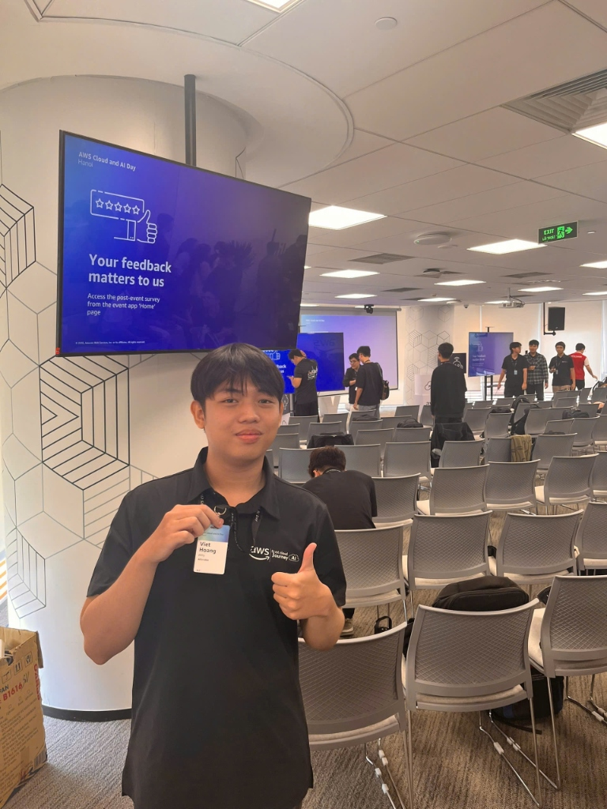
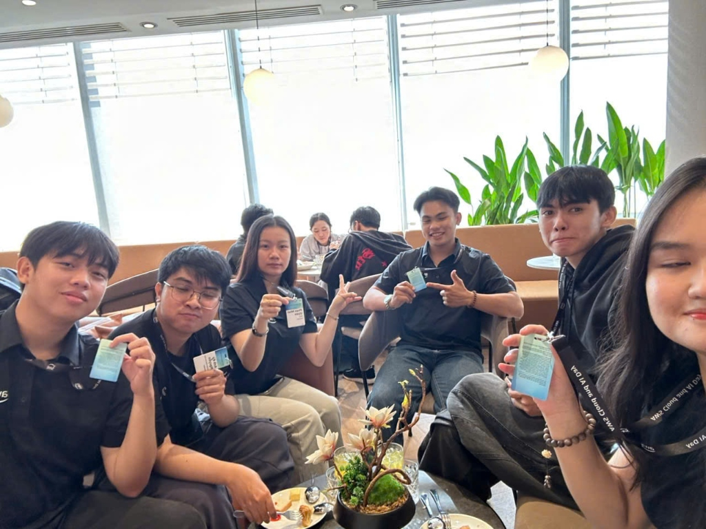

# **Event 2: AWS Cloud & AI Day 2026 – HCMC Watch Party**

**Date:** Tuesday, September 29, 2026  
**Time:** 08:00 AM – 05:00 PM (GMT+7)  
**Location:** Amazon Web Services Vietnam Office, 26th Floor, Bitexco Financial Tower, Ho Chi Minh City, Vietnam.  
**Role:** Attendee  
**Event Post:** [View on Facebook – AWS Study Group](https://www.facebook.com/share/p/1ArkgMT1KM/)

### **Event Objectives**

* Track the latest industry shifts across Cloud Computing and Artificial Intelligence.
* Deepen understanding of Agentic AI, modern data foundations, and enterprise cloud modernization.
* Observe how real organizations build, scale, and operate workloads on AWS.
* Connect and share insights with fellow cloud builders across the Vietnam AWS community.

### **Key Highlights**

#### **Agentic AI & Modern Software Development**
* Examined how autonomous AI Agents are increasingly embedded into software workflows to handle complex tasks.
* Discussed the operational hurdles of promoting AI Agents from early experiments into dependable production systems.
* Broadened perspective on how AI speeds up development cycles and enhances product capabilities.

#### **Data Foundation & Cloud Modernization**
* Highlighted why a clean, well-governed data layer is the prerequisite for any reliable Cloud and AI solution.
* Explored practical pathways for modernizing legacy applications on AWS while matching architecture choices to genuine business needs.

#### **Cloud Operations & Cost Optimization**
* Reviewed day-two operational considerations when running applications on AWS.
* Emphasized finding the right equilibrium between latency, scalability, and cloud spend, especially when adopting AI services.

### **Key Takeaways & Application**

* **Cloud & AI Convergence:** Reinforced that strong cloud fundamentals remain indispensable when shipping AI-powered applications.
* **Pragmatic Architecture & FinOps:** Learned to evaluate architectures against workload scale and budget rather than chasing trends blindly.
* **Preparation for Cloud Practice & Team Work:** Used these architecture, performance, and cost-awareness principles as a foundation for subsequent AWS service research and team architecture discussions during the internship.

### **Event Experience**

Joining the HCMC Watch Party at the AWS Vietnam office made it easy to follow the live sessions from Hanoi while exchanging ideas directly with builders in Ho Chi Minh City. The discussions around Agentic AI, data infrastructure, and cost-conscious cloud operations reinforced the value of peer learning inside the AWS Study Group and gave me clear technical topics to explore further during the internship.

### **Event Photos**

 
