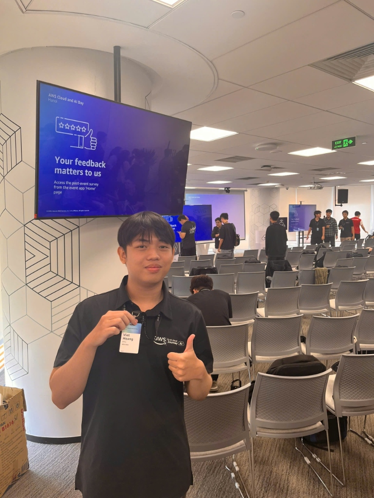
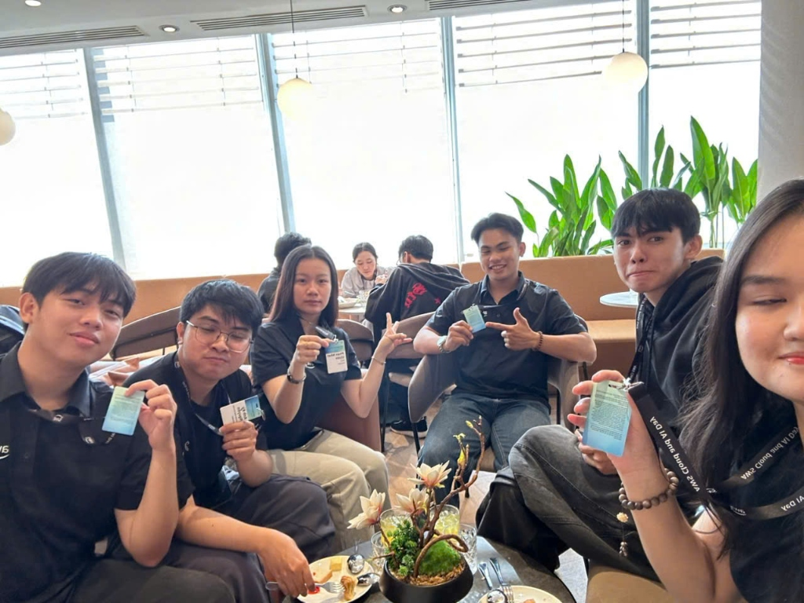

# **Sự kiện 2: AWS Cloud & AI Day 2026 – Watch Party TP.HCM**

**Ngày:** Thứ Ba, ngày 29 tháng 09 năm 2026  
**Thời gian:** 08:00 AM – 05:00 PM (GMT+7)  
**Địa điểm:** Văn phòng AWS Việt Nam, Tầng 26, Bitexco Financial Tower, TP. Hồ Chí Minh, Việt Nam.  
**Vai trò:** Người tham dự  
**Bài đăng sự kiện:** [Xem trên Facebook – AWS Study Group](https://www.facebook.com/share/p/1ArkgMT1KM/)

### **Mục tiêu sự kiện**

* Cập nhật các xu hướng mới nổi trong lĩnh vực Điện toán đám mây và Trí tuệ nhân tạo.
* Tìm hiểu sâu hơn về Agentic AI, nền tảng dữ liệu hiện đại và chiến lược hiện đại hóa hệ thống trên đám mây.
* Quan sát cách doanh nghiệp ứng dụng dịch vụ AWS để xây dựng và vận hành hệ thống thực tế.
* Kết nối và trao đổi kinh nghiệm với cộng đồng kỹ sư AWS tại Việt Nam.

### **Nội dung nổi bật**

#### **Agentic AI & Phát triển phần mềm hiện đại**
* Tìm hiểu vai trò ngày càng rõ nét của AI Agent trong việc hỗ trợ tự động hóa các tác vụ phức tạp trong ứng dụng phần mềm.
* Phân tích các thách thức thực tế khi đưa AI Agent từ giai đoạn thử nghiệm (prototype) lên vận hành ổn định trong sản xuất.

#### **Nền tảng dữ liệu & Hiện đại hóa hạ tầng đám mây**
* Nhấn mạnh vai trò thiết yếu của hạ tầng dữ liệu trong việc phát triển ứng dụng Cloud và AI.
* Tìm hiểu hướng tiếp cận hiện đại hóa hệ thống và chọn lựa kiến trúc phù hợp với bài toán nghiệp vụ thực tế.

#### **Vận hành đám mây & Tối ưu chi phí**
* Xem xét các yếu tố cốt lõi khi triển khai và vận hành ứng dụng trên AWS.
* Chú trọng cân bằng giữa hiệu năng, khả năng mở rộng và chi phí vận hành khi áp dụng AI vào thực tiễn.

### **Bài học rút ra & Ứng dụng**

* **Gắn kết Cloud & AI:** Kiến thức nền tảng về điện toán đám mây luôn là bệ phóng không thể thiếu khi phát triển ứng dụng tích hợp AI.
* **Kiến trúc thực dụng & Tối ưu chi phí:** Đánh giá kỹ yêu cầu quy mô hệ thống và giám sát chi phí dịch vụ ngay từ giai đoạn thiết kế.
* **Ứng dụng vào dự án ReLoop:** Áp dụng các nguyên tắc lựa chọn kiến trúc, hiệu năng và kiểm soát chi phí vào quá trình thảo luận và nghiên cứu dịch vụ AWS cho dự án nhóm.

### **Trải nghiệm sự kiện**

Tham gia Watch Party tại văn phòng AWS Việt Nam ở TP.HCM giúp tôi vừa theo dõi trực tiếp các phiên chia sẻ từ đầu cầu Hà Nội, vừa có cơ hội thảo luận và mở rộng kết nối với cộng đồng AWS Study Group. Sự kiện không chỉ mở rộng góc nhìn về Cloud & AI mà còn gợi mở nhiều chủ đề thực tế để tiếp tục đào sâu trong suốt kỳ thực tập.

### **Hình ảnh sự kiện**

 
