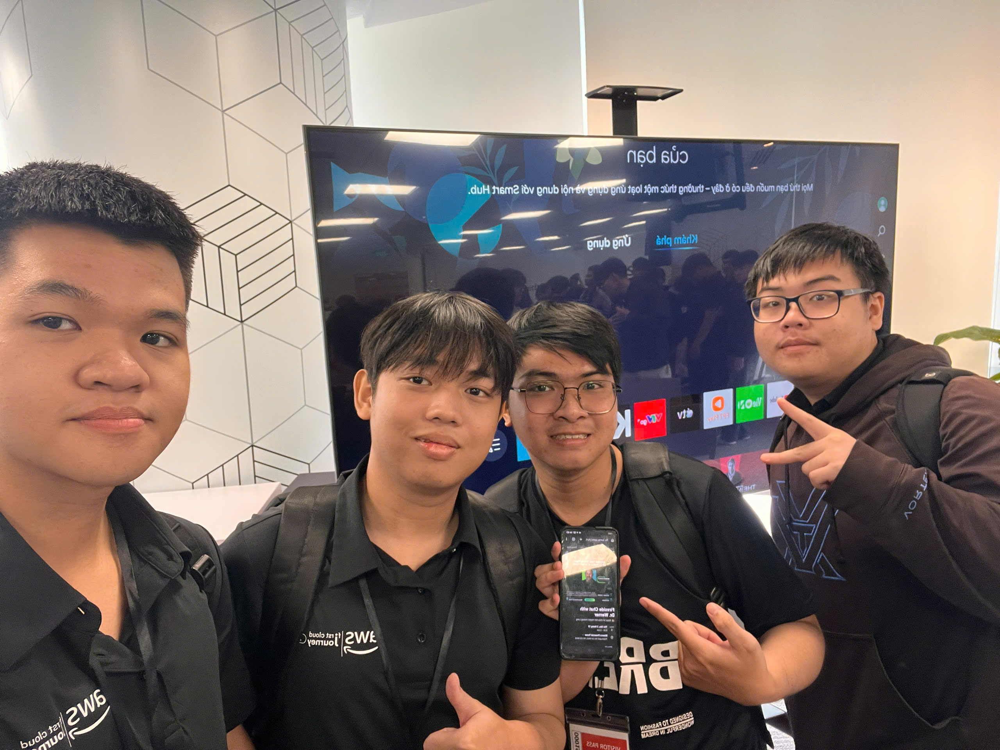

# **Event 3: Fireside Chat with Dr. Werner – Navigating the Future of Cloud & AI in Vietnam**

**Date:** Friday, October 2, 2026  
**Time:** 10:30 AM – 12:00 PM (GMT+7)  
**Location:** Bitexco Financial Tower, 02 Hai Trieu Street, Ho Chi Minh City, Vietnam.  
**Role:** Attendee  
**Event Video:** [Watch on YouTube](https://www.youtube.com/watch?v=jWjOIfMA9qc&t=1s)

### **Event Objectives**

* Explore the long-term trajectory of Cloud Computing and Artificial Intelligence in Vietnam.
* Absorb strategic lessons on large-scale distributed systems directly from AWS executive leadership.
* Examine how software engineering, system design, and developer responsibilities are shifting in the AI era.

### **Speaker**

* **Dr. Werner Vogels** – Chief Technology Officer (CTO) of Amazon, widely recognized for his pioneering work in distributed systems and cloud architecture.

### **Key Highlights**

#### **The Origins of AWS**
* Traced how AWS began and evolved to support workloads ranging from early startups to global enterprises.
* Highlighted the core design philosophy behind building reliable, self-service cloud infrastructure for millions of builders.

#### **Engineering at Scale**
* Discussed the realities of designing and operating systems serving massive user traffic and request volumes.
* Underscored why reliability, automation, and horizontal scalability must be treated as first-class architectural goals.

#### **The Renaissance Developer**
* Explored how modern engineers are evolving alongside AI assistants—blending deep computer science fundamentals with AI-driven workflows to work at a higher level of abstraction.

#### **AI, Prototyping, and Engineering Pride**
* Showed how AI dramatically shortens the cycle from idea to working prototype.
* Stressed that even when AI generates code, engineers remain fully accountable for system quality, correctness, and architectural trade-offs.

### **Key Takeaways & Application**

* **Scalability & Fundamentals First:** Design systems with growth in mind while matching actual requirements; solid engineering fundamentals matter more than ever when collaborating with AI tools.
* **Fast Prototyping with Rigorous Verification:** Use AI to validate ideas quickly, then verify thoroughly before shipping to production.
* **Evolving Developer Role:** Embrace the *"Renaissance Developer"* mindset—letting AI handle repetitive work while focusing human effort on architecture, complex debugging, and continuous learning through FCAJ.

### **Event Experience**

Following the fireside chat with Dr. Werner Vogels offered rare strategic perspective from one of the pioneers of modern cloud computing. Hearing his framing of the *"Renaissance Developer"* clarified how AI acts as a force multiplier rather than a replacement for sound engineering judgment, leaving strong inspiration to sharpen both my architectural thinking and hands-on cloud skills.

### **Event Photos**

