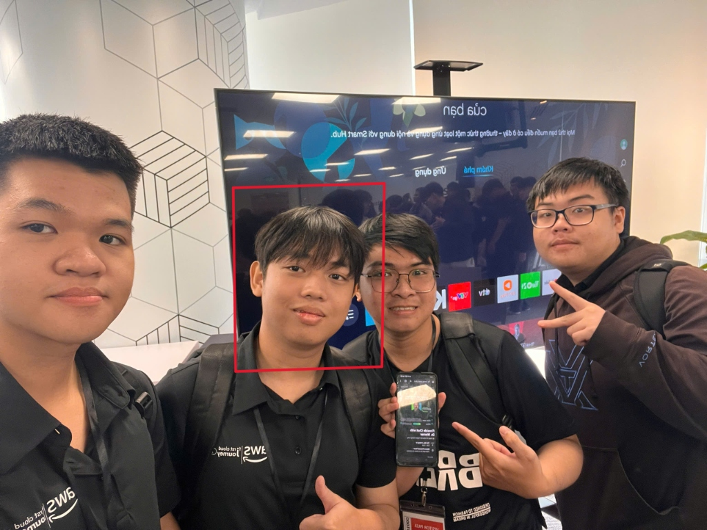

# **Sự kiện 3: Trò chuyện thân mật cùng TS. Werner Vogels – Định hình tương lai Cloud & AI tại Việt Nam**

**Ngày:** Thứ Sáu, ngày 02 tháng 10 năm 2026  
**Thời gian:** 10:30 AM – 12:00 PM (GMT+7)  
**Địa điểm:** Tòa nhà Bitexco Financial Tower, số 02 Hải Triều, TP. Hồ Chí Minh, Việt Nam.  
**Vai trò:** Người tham dự  
**Video sự kiện:** [Xem trên YouTube](https://www.youtube.com/watch?v=jWjOIfMA9qc&t=1s)

### **Mục tiêu sự kiện**

* Thảo luận tầm nhìn tương lai của Điện toán đám mây và Trí tuệ nhân tạo tại Việt Nam.
* Lĩnh hội góc nhìn chiến lược về thiết kế và vận hành hệ thống quy mô lớn từ lãnh đạo công nghệ hàng đầu của AWS.
* Khám phá xu hướng kiến trúc ứng dụng và sự chuyển dịch vai trò của lập trình viên trong kỷ nguyên AI.

### **Diễn giả**

* **TS. Werner Vogels** – Giám đốc Công nghệ (CTO) của Amazon, người có nhiều năm dẫn dắt lĩnh vực hệ thống phân tán và điện toán đám mây toàn cầu.

### **Nội dung nổi bật**

#### **Khởi nguồn của AWS**
* Nhìn lại hành trình hình thành và phát triển của Amazon Web Services cùng tư duy nền tảng khi xây dựng hạ tầng đám mây phục vụ khách hàng từ quy mô nhỏ đến toàn cầu.

#### **Kỹ nghệ hệ thống ở quy mô lớn (Engineering at Scale)**
* Phân tích các bài toán cốt lõi khi vận hành hệ thống chịu tải lớn, nhấn mạnh vai trò không thể thay thế của độ tin cậy, tự động hóa và khả năng mở rộng.

#### **Hình mẫu "Renaissance Developer"**
* Khám phá vai trò mới của kỹ sư phần mềm khi công cụ AI ngày càng phổ biến: kết hợp nền tảng lập trình vững chắc với công cụ AI để tối ưu năng suất và giải quyết bài toán phức tạp hơn.

#### **AI, Tạo mẫu nhanh và Tinh thần trách nhiệm kỹ sư**
* AI giúp rút ngắn đáng kể thời gian dựng prototype và kiểm chứng ý tưởng, nhưng lập trình viên vẫn là người chịu trách nhiệm cuối cùng về chất lượng mã nguồn và các quyết định kỹ thuật.

### **Bài học rút ra & Ứng dụng**

* **Tư duy mở rộng & Nền tảng vững chắc:** Thiết kế hệ thống sẵn sàng mở rộng nhưng vừa vặn với nhu cầu thực tế; kiến thức nền tảng về hệ thống và kiến trúc vẫn là yếu tố quyết định khi làm việc cùng AI.
* **Tạo mẫu nhanh đi kèm kiểm chứng kỹ:** Tận dụng AI để tăng tốc viết mã, kiểm thử và thử nghiệm ý tưởng trong dự án nhóm, song luôn rà soát cẩn trọng trước khi triển khai thực tế.
* **Chủ động nâng cấp bản thân:** Rèn luyện tư duy của một kiến trúc sư và người giải quyết vấn đề, liên tục cập nhật xu hướng Cloud & AI qua chương trình First Cloud AI Journey.

### **Trải nghiệm sự kiện**

Buổi trò chuyện cùng TS. Werner Vogels mang lại góc nhìn chiến lược sâu sắc về tương lai Cloud và AI tại Việt Nam cũng như trên thế giới. Khái niệm *"Renaissance Developer"* giúp tôi nhìn nhận rõ hơn rằng công cụ AI là đòn bẩy mạnh mẽ, còn tư duy kỹ thuật và trách nhiệm của con người mới là yếu tố cốt lõi, tạo nguồn cảm hứng lớn cho hành trình phát triển nghề nghiệp kỹ sư phần mềm.

### **Hình ảnh sự kiện**

