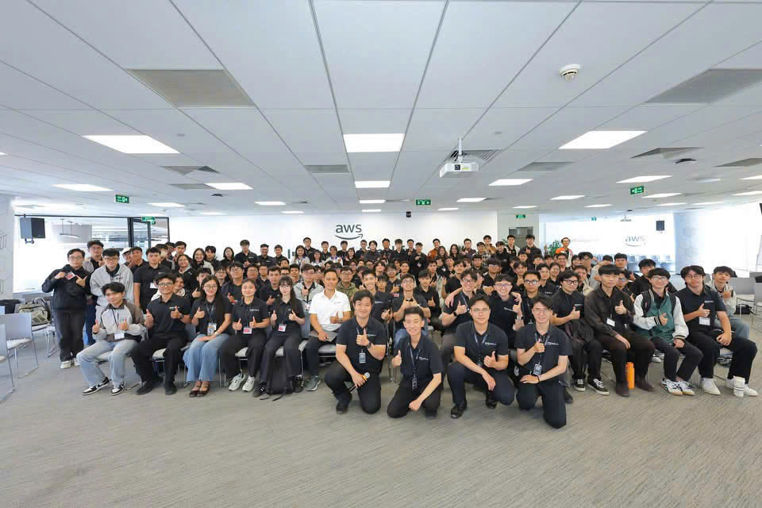
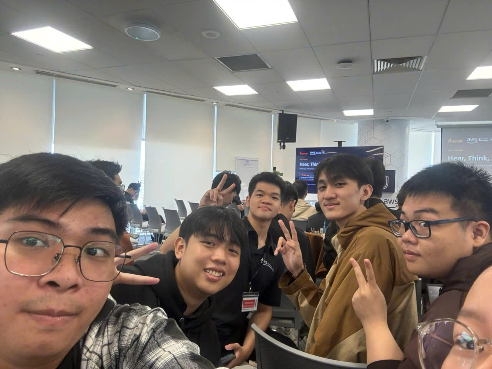

# **Event 4: First Cloud AI Journey – Weekly Meet Up (24/10)**

**Date:** Saturday, October 24, 2026  
**Time:** 10:30 AM – 12:00 PM (GMT+7)  
**Location:** AWS Vietnam Office, 26th Floor, Bitexco Financial Tower, 02 Hai Trieu Street, Ho Chi Minh City, Vietnam.  
**Role:** Attendee  
**Event Video:** [Watch on YouTube](https://www.youtube.com/watch?v=dJiP5890kTg)

### **Event Objectives**

* Acquire practical insights into Cloud architecture and production AI Agent engineering from active Tech Leads and industry engineers.
* Examine hands-on strategies for optimizing AWS infrastructure, multi-account security, and cloud cost efficiency.
* Understand how Voice AI, Security/Pentest Agents, and production Agent Frameworks are architected and operated.
* Exchange ideas and network with the AWS Student Builder Group community and practitioners.

### **Speakers**

* **Kiet Tran** – Revve AI  
* **Long Huynh** – Styl Solution  
* **Thinh Nguyen** – Styl Solution  
* **Xuan An** – Leader, AWS Student Builder Group HCMUTE  
* **Khoa Kieu** – Tech Lead, ACB  
* **Nghi Danh** – AWS Community Builder  

### **Key Highlights**

#### **Session 1: Hear, Think, Speak – Vietnamese Voice-AI Contact Center on AWS**
* Explored pipeline optimizations that bring end-to-end voice response latency down to roughly **1.8 seconds**, making conversations feel fluid and natural.
* Watched a live Vietnamese Voice AI agent conduct an automated screening interview for a Cloud Engineer candidate with dynamic follow-up responses.

#### **Session 2: AWS Resource Access Manager (RAM)**
* Reviewed how organizations share networking and infrastructure resources across separate AWS accounts inside AWS Organizations to cut duplication and simplify central governance.
* Saw how combining IAM policies with Service Control Policies (SCPs) enforces strict permission boundaries and prevents unintended privilege escalation.

#### **Session 3: AWS Pentest with AWS Continuum / Security Agent**
* Looked at *"Shift-Left"* IaC security: running automated Terraform security checks directly inside GitHub/GitLab pull requests before code merges.
* Explored autonomous Security Agents simulating realistic user behavior to execute automated penetration tests in SIT/UAT environments ahead of production release.

#### **Session 4: Amazon Bedrock AgentCore**
* Learned how running MicroVM-isolated agent runtimes on EC2 Spot instances helps control compute spend for agentic workloads.
* Studied layered memory design—separating synchronous short-term session state from asynchronous long-term user memory—to keep agent responses relevant.

#### **Session 5: Kiro Crew – 24/7 AI Agent for Code Review & System Monitoring**
* Examined always-on AI Agents assisting with continuous code reviews, operational monitoring, and generating visual charts directly inside chat interfaces.
* Explored context-window hygiene: **Auto Compact** compressing conversation history at 70–90% capacity, **Break Down Context** inspecting token usage by component, and strict **Guardrails** blocking destructive infrastructure actions or credential leaks while pruning stale memory.

### **Key Takeaways & Application**

* **Latency, Security & Cost Balance:** Learned practical trade-offs across Voice AI latency, early Shift-Left security scanning in CI/CD, and managing token/Spot costs for continuous AI Agents.
* **Defense-in-Depth for Cloud & GenAI:** Reinforced how IAM + SCPs with AWS RAM enforce least privilege, while Guardrails protect infrastructure from unsafe agent commands.
* **Applied to Projects & Learning:** Plan to integrate Terraform IaC checks into pull request workflows, apply layered memory and context compression patterns when building LLM features, and practice AWS Organizations, RAM, and SCP setups.

### **Event Experience**

Attending the October 24 weekly meetup on the 26th floor of Bitexco Financial Tower offered dense, real-world engineering lessons across five focused talks. Revve AI's ~1.8-second live Voice AI interview demo stood out immediately, while the sessions from Styl Solution, HCMUTE, and ACB illuminated production realities around multi-account security, AgentCore memory, and 24/7 agent guardrails. Seeing the gap between classroom concepts and enterprise operations gave me clearer direction for sharpening my cloud and security engineering skills.

### **Event Photos**

 
