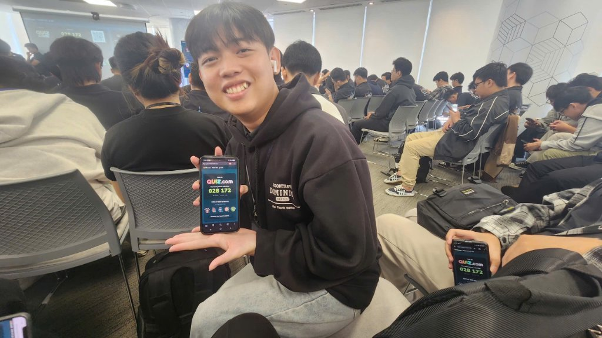

# **Event 5: Cloud Mastery – Cloud Sharing Session for Students**

**Date:** Saturday, November 14, 2026  
**Time:** Morning (GMT+7)  
**Location:** AWS Vietnam Office, Bitexco Financial Tower, Ho Chi Minh City, Vietnam.  
**Role:** Attendee  
**Event Recap:** [View on Facebook](https://www.facebook.com/share/p/1E3kZ8yC7h/)

### **Event Objectives**

* Share practical cloud computing knowledge and learning strategies with university students.
* Answer hands-on questions covering technical foundations, essential competencies, and career directions in cloud engineering.
* Build an open space for technology-minded students to connect, exchange perspectives, and learn together.

### **Key Highlights**

#### **Cloud Knowledge Sharing & Career Guidance**
* Outlined clear learning roadmaps and core skills students should prioritize when getting started with cloud platforms.
* Discussed realistic career tracks in cloud computing grounded in questions raised directly by attendees.

#### **Interactive Question & Answer (Q&A) Session**
* Addressed practical student concerns about overcoming early learning hurdles, selecting projects, and growing technical depth.
* High engagement and thoughtful follow-up questions extended the Q&A well past its scheduled slot.

#### **End-of-Event Quiz Activity & Upcoming Community Event**
* Closed the morning with an energetic live quiz game joined by over 100 participants to reinforce key session takeaways.
* Announced **AWS Student Community Day Vietnam 2026**, scheduled for the following weekend.

### **Key Takeaways & Application**

* **Foundations Meet Practice:** Strong cloud fundamentals only pay off when paired with hands-on projects and real security awareness.
* **Proactive Community Learning:** Asking direct questions and exchanging experiences with peers and mentors accelerates both technical growth and career clarity.
* **Applied to My Journey:** Prompted me to review the cloud and cybersecurity skills gained during the First Cloud AI Journey internship, pinpoint areas for post-internship growth, and stay active in the AWS community.

### **Event Experience**

Spending Saturday morning (November 14, 2026) at the AWS Vietnam office in Bitexco Financial Tower was a refreshing, welcoming community experience. Seeing how enthusiastically students engaged throughout the extended Q&A—and joining over 100 peers in the closing quiz—gave me space to reflect on my own progress during FCAJ and reinforced my commitment to advancing both my cloud architecture and information security skills.

### **Event Photos**

