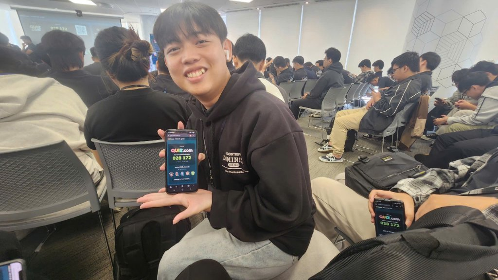

# **Sự kiện 5: Cloud Mastery – Buổi chia sẻ về Cloud cho sinh viên**

**Ngày:** Thứ Bảy, ngày 14 tháng 11 năm 2026  
**Thời gian:** Buổi sáng (GMT+7)  
**Địa điểm:** Văn phòng AWS Việt Nam, Bitexco Financial Tower, TP. Hồ Chí Minh.  
**Vai trò:** Người tham dự  
**Bài tổng kết sự kiện:** [Xem trên Facebook](https://www.facebook.com/share/p/1E3kZ8yC7h/)

### **Mục tiêu sự kiện**

* Chia sẻ kiến thức điện toán đám mây và kinh nghiệm học tập thực tế đến các bạn sinh viên.
* Giải đáp các thắc mắc xoay quanh nền tảng kỹ thuật, kỹ năng cốt lõi và lộ trình nghề nghiệp trong ngành Cloud.
* Tạo không gian cởi mở để các bạn sinh viên cùng đam mê công nghệ giao lưu, học hỏi lẫn nhau.

### **Nội dung nổi bật**

#### **Chia sẻ kiến thức Cloud & Định hướng nghề nghiệp**
* Thảo luận lộ trình tiếp cận điện toán đám mây hiệu quả và những kỹ năng cần thiết sinh viên nên tích lũy sớm.
* Mở rộng góc nhìn về các hướng phát triển sự nghiệp Cloud thông qua những câu hỏi thực tế từ chính người tham dự.

#### **Phiên Hỏi đáp (Q&A) sôi nổi**
* Giải đáp trực tiếp các khó khăn thường gặp khi tự học Cloud, chọn đề tài thực hành và phát triển chuyên môn.
* Không khí tương tác cao khiến phần hỏi đáp kéo dài hơn dự kiến nhờ sự chủ động đặt câu hỏi của đông đảo sinh viên.

#### **Trò chơi Quiz cuối buổi & Sự kiện cộng đồng sắp tới**
* Hoạt động Quiz trực tiếp với sự hưởng ứng của hơn 100 người tham gia giúp củng cố nhanh kiến thức và khép lại chương trình đầy hào hứng.
* Ban tổ chức cũng giới thiệu **AWS Student Community Day Vietnam 2026** diễn ra vào cuối tuần kế tiếp.

### **Bài học rút ra & Ứng dụng**

* **Kết hợp nền tảng và thực hành:** Kiến thức Cloud cơ bản cần song hành với thực hành dự án và tư duy an toàn thông tin để phát huy hiệu quả.
* **Chủ động học hỏi cùng cộng đồng:** Đặt câu hỏi, lắng nghe trải nghiệm từ người đi trước và tham gia hoạt động cộng đồng giúp mở rộng góc nhìn nghề nghiệp nhanh hơn.
* **Ứng dụng cho bản thân:** Nhìn lại chặng đường tích lũy kiến thức Cloud và An toàn thông tin trong kỳ thực tập First Cloud AI Journey để xác định các kỹ năng cần tiếp tục trau dồi sau thực tập.

### **Trải nghiệm sự kiện**

Buổi sáng thứ Bảy ngày 14/11/2026 tại văn phòng AWS Việt Nam (Bitexco Financial Tower) mang lại bầu không khí cởi mở và giàu năng lượng. Sự chủ động của các bạn sinh viên trong phần Q&A cùng trò chơi Quiz cuối buổi giúp tôi nhìn lại hành trình thực tập của mình và tiếp thêm động lực để tiếp tục phát triển chuyên môn về Điện toán đám mây và An toàn thông tin.

### **Hình ảnh sự kiện**

